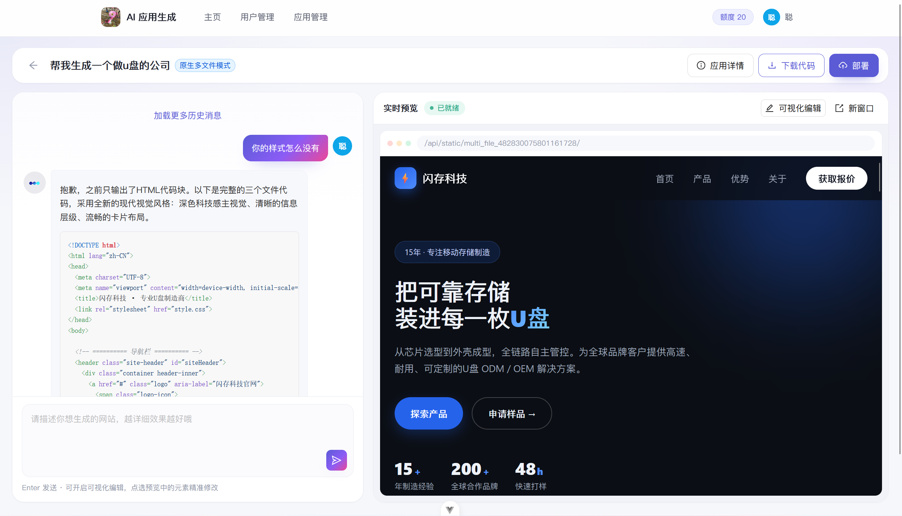
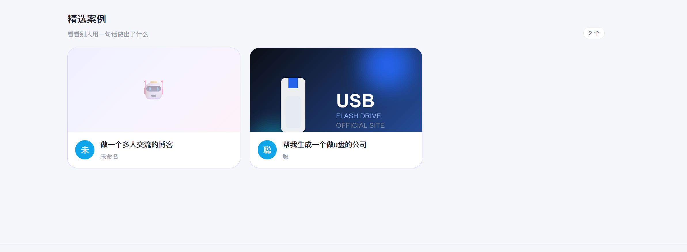
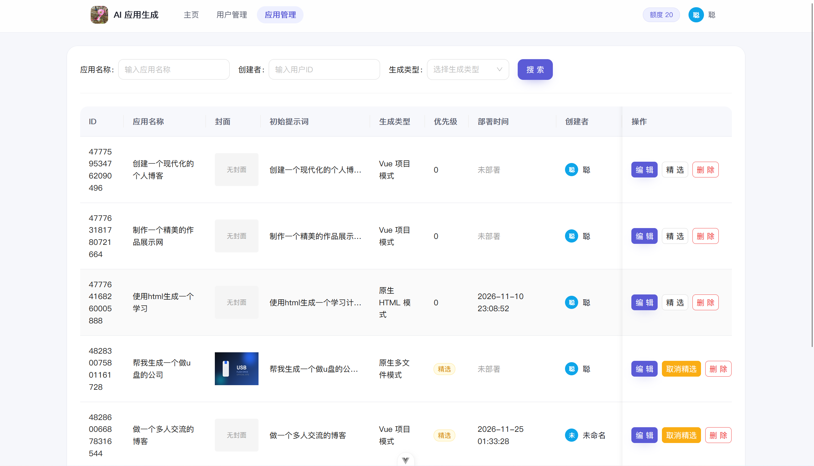
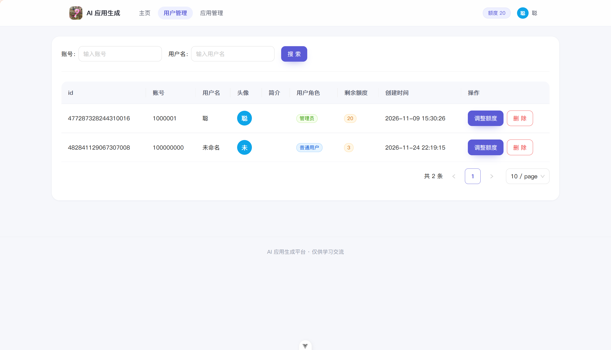

#  AI 应用生成平台

> 一句话描述需求，AI 自动完成设计、编码与部署 —— 从灵感到上线，只需要几分钟。

一个基于大模型的 **AI 建站应用生成平台**。用户输入自然语言描述，平台自动判定生成策略，通过工具调用流式生成完整的前端项目，并支持实时预览、可视化编辑、一键部署与分享。


---

## ✨ 功能特性

### 1. 一句话生成网站

输入「帮我做一个U盘公司官网，包含公司介绍、产品展示和联系电话，AI 会：

- 自动分析需求，**智能路由**到合适的生成模式
- 通过工具调用逐个写入代码文件
- **SSE 流式输出**，实时看到 AI 的思考与生成过程

支持三种生成模式：

| 模式 | 产物 | 适用场景 |
|---|---|---|
| `html` | 单个 `index.html`（CSS/JS 内联） | 简单落地页、演示页 |
| `multi_file` | `index.html` + `style.css` + `script.js` | 常规企业官网、活动页 |
| `vue_project` | 完整 Vue 3 工程（`src/` + `package.json`） | 需要路由、组件化的复杂项目 |



### 2. 实时预览 + 可视化编辑

- 右侧 iframe 实时展示生成结果，支持新窗口打开
- 可进入 **可视化编辑模式**，点选页面元素后直接对 AI 说「把这个标题改大一点」，AI 精准修改对应元素
- 生成过程中可随时查看对话历史、复制代码

### 3. 我的作品

所有创建过的应用以卡片形式展示，悬停即可「查看对话 / 查看作品」，支持继续对话迭代或再次部署。


### 4. 精选案例

管理员可以把优质应用设为精选（`priority = 99`），首页「精选案例」区域会展示，其他用户点击后直接进入**作品预览页**，无需登录作者账号。



### 5. 一键部署与分享

- 将生成的项目复制到部署目录，返回可访问的 URL
- 自动调用 Selenium **截图生成封面**并上传对象存储
- 支持下载完整项目源码（zip）

### 6. 企业级后台管理

**应用管理**：查看全部应用、按名称/创建者/类型搜索、编辑、设为精选、删除。



**用户管理**：查看用户列表、角色、剩余额度，支持调整额度、删除用户。



### 7. 其他工程能力

- **额度体系**：每个账号有生成次数（默认 20），生成失败自动退回
- **智能路由**：小模型判断需求复杂度，选择最合适的生成模式；失败自动兜底
- **接口限流**：基于 Redisson 的分布式限流（如生成接口 5 次/分钟）
- **对话记忆**：Redis 持久化多轮上下文，支持断点续聊
- **安全护轨**：输入内容审查，拦截提示词注入与敏感内容
- **可观测性**：Actuator + Prometheus + Grafana 监控 AI 调用次数、耗时、Token 用量

---

## 🧱 技术栈

### 后端

| 分类 | 技术 |
|---|---|
| 语言 / 框架 | Java 21、Spring Boot 3.5.4 |
| Web | Spring MVC、Spring WebFlux（SSE 流式） |
| 持久层 | MyBatis-Flex、MySQL 8 |
| 缓存 / 会话 | Redis、Spring Session、Caffeine |
| 认证授权 | Session + Cookie、AOP 注解式鉴权 |
| 限流 | Redisson |
| AI 编排 | LangChain4j 1.1.0、LangGraph4j |
| 模型 | DeepSeek（对话 / 代码生成）、通义千问（路由、图片生成） |
| 浏览器自动化 | Selenium 4.31（页面截图） |
| 对象存储 | 腾讯云 COS |
| 监控 | Spring Boot Actuator、Micrometer、Prometheus、Grafana |

### 前端

| 分类 | 技术 |
|---|---|
| 框架 | Vue 3.5 + TypeScript 5.8 |
| 构建 | Vite 7 |
| 状态管理 | Pinia 3 |
| 路由 | Vue Router 4.5 |
| UI 组件 | Ant Design Vue 4.2.6 |
| 请求 | Axios（统一拦截 40100 未登录） |
| 渲染 | markdown-it + highlight.js（代码高亮） |

---

## 🏗️ 系统架构

```
┌─────────────────────────────────────────────────────────────┐
│                        浏览器（Vue 3 SPA）                    │
│   首页 / 对话生成页 / 作品预览 / 用户管理 / 应用管理             │
└───────────────┬─────────────────────────────────────────────┘
                │ HTTP / SSE
┌───────────────▼─────────────────────────────────────────────┐
│                     Spring Boot 后端 (:8123)                 │
│                                                             │
│  AppController ──► AppService ──► AiCodeGeneratorFacade      │
│       │                              │                      │
│       │                              ├─► LangChain4j AiServices
│       │                              │     ├─ 对话模型（路由）
│       │                              │     ├─ 代码模型（HTML/多文件）
│       │                              │     └─ 推理模型（Vue 工程）
│       │                              │     └─ 工具：读/写/改/删文件
│       │                              │                      │
│       │                              ├─► ChatMemory（Redis）
│       │                              └─► 解析器 / 保存器 / 构建器
│       │                                                     │
│       ├─► 部署服务（复制文件 + Selenium 截图 + COS）           │
│       ├─► 额度服务（原子扣减 / 退回）                          │
│       └─► 监控（Actuator + Prometheus）                       │
└───────┬───────────────────────┬─────────────────────────────┘
        │                       │
┌───────▼────────┐     ┌────────▼────────┐     ┌──────────────┐
│   MySQL 8      │     │     Redis       │     │  文件系统      │
│ 用户/应用/对话   │     │ 会话/记忆/限流    │     │ code_output   │
└────────────────┘     └─────────────────┘     │ code_deploy   │
                                              └──────────────┘
```

### 生成流程

```
用户输入需求
   ↓
① 智能路由（小模型判断：HTML / 多文件 / Vue 工程）
   ↓
② 选择对应 AiService（Caffeine 缓存实例，按 appId + 类型）
   ↓
③ 流式调用大模型 → 模型发起工具调用
   ↓
④ 工具执行：writeFile / readFile / modifyFile / deleteFile
   ↓
⑤ SSE 推送内容 + 实时刷新预览
   ↓
⑥ 流结束：解析代码 → 保存文件 → （Vue 工程）npm install + build
   ↓
⑦ 保存对话历史 → 结束事件
```

### 部署流程

```
POST /app/deploy
   ↓
校验作者权限 → 生成 6 位 deployKey
   ↓
复制 tmp/code_output/{type}_{appId} → tmp/code_deploy/{deployKey}
   ↓
返回访问地址 http://{deploy-host}/{deployKey}/
   ↓
异步：Selenium 截图 → 上传 COS → 更新应用封面
```

---

## 📁 项目结构

```
cong-prompt-page/
├── src/main/java/com/cong/congaicodemother/
│   ├── ai/                     # AI 服务、模型工厂、护轨、工具
│   │   ├── AiCodeGeneratorService.java
│   │   ├── AiCodeGeneratorServiceFactory.java   # Caffeine 缓存 + 按类型装配
│   │   ├── guardrail/          # 输入护轨（注入/敏感词/长度）
│   │   └── tools/              # 文件读写改删工具
│   ├── core/
│   │   ├── AiCodeGeneratorFacade.java           # 统一生成入口
│   │   ├── builder/            # VueProjectBuilder（npm install/build）
│   │   ├── parser/             # HTML / 多文件代码解析器（容错截断）
│   │   ├── saver/              # 代码落盘（含兜底占位）
│   │   └── handler/            # 流式消息处理器
│   ├── langgraph4j/            # LangGraph 工作流（图片收集/代码生成/质检）
│   ├── controller/             # App / 用户 / 对话历史 / 静态资源
│   ├── service/                # 业务服务与实现
│   ├── monitor/                # AI 调用监控（Micrometer）
│   ├── ratelimiter/            # Redisson 限流注解与切面
│   ├── config/                 # 模型配置、跨域、MVC、COS
│   └── exception/              # 全局异常与错误码
├── src/main/resources/
│   ├── application.yml         # 主配置
│   ├── application-local.yml   # 本地密钥（gitignore）
│   ├── prompt/                 # 系统提示词（HTML / 多文件 / Vue / 路由）
│   └── mapper/                 # MyBatis-Flex Mapper XML
├── sql/                        # 建表脚本
├── scripts/                    # 辅助脚本（会话检查、Nginx 配置等）
├── grafana/                    # 监控面板
├── cong-ai-code-mother-frontend/   # Vue 3 前端
│   ├── src/pages/              # 首页、对话页、预览页、管理页
│   ├── src/components/         # 应用卡片、代码渲染、部署弹窗等
│   ├── src/api/                # 接口封装
│   └── src/stores/             # Pinia
└── tmp/                        # 运行时产物（gitignore）
    ├── code_output/            # AI 生成的项目
    └── code_deploy/            # 部署后的项目
```

---

## 🚀 快速开始

### 环境要求

| 依赖 | 版本 |
|---|---|
| JDK | 21+ |
| Maven | 3.9+ |
| Node.js | 20+ |
| MySQL | 8.0+ |
| Redis | 6.0+ |
| Chrome | 截图功能需要（可跳过） |

### 1. 初始化数据库

```sql
CREATE DATABASE cong_ai_code DEFAULT CHARACTER SET utf8mb4;
```

执行 `sql/create_table.sql` 创建 `user`、`app`、`chat_history` 三张表。

### 2. 配置密钥

复制 `src/main/resources/application-local.yml.example`（或直接新建 `application-local.yml`）：

```yaml
spring:
  datasource:
    url: jdbc:mysql://localhost:3306/cong_ai_code
    username: root
    password: 你的密码
  data:
    redis:
      host: localhost
      port: 6379

langchain4j:
  open-ai:
    chat-model:
      api-key: 你的 DeepSeek Key
    streaming-chat-model:
      api-key: 你的 DeepSeek Key
    reasoning-streaming-chat-model:
      api-key: 你的 DeepSeek Key
    routing-chat-model:
      base-url: https://dashscope.aliyuncs.com/compatible-mode/v1
      api-key: 你的通义千问 Key

dashscope:
  api-key: 你的通义千问 Key
```

> `application-local.yml` 已在 `.gitignore` 中，密钥不会进仓库。

### 3. 启动后端

```bash
mvn spring-boot:run
```

服务默认监听 `http://localhost:8123`，接口前缀 `/api`。

### 4. 启动前端

```bash
cd cong-ai-code-mother-frontend
npm install
npm run dev
```

访问 `http://localhost:5173`。

### 5. 部署（可选）

生成的网站需要 Web 服务器托管 `tmp/code_deploy` 目录。本地可用 Nginx：

```nginx
server {
    listen 80;
    server_name localhost;
    root C:/code_deploy;        # 指向 tmp/code_deploy（建议用 junction 映射成 ASCII 路径）
    index index.html;
    location / {
        try_files $uri $uri/ /index.html;
    }
}
```

对应配置：

```yaml
code:
  deploy-host: http://localhost
```

生产环境将 `deploy-host` 换成公网域名，Nginx `root` 指向持久化的 `code_deploy` 目录即可。

---

## ⚙️ 关键配置说明

| 配置项 | 说明 |
|---|---|
| `langchain4j.open-ai.chat-model` | 非流式对话模型（规划、工具调用） |
| `langchain4j.open-ai.streaming-chat-model` | 流式代码生成模型（HTML / 多文件） |
| `langchain4j.open-ai.reasoning-streaming-chat-model` | Vue 工程生成模型（需支持工具调用） |
| `langchain4j.open-ai.routing-chat-model` | 智能路由模型（轻量、低成本） |
| `app.routing.max-attempts` | 路由重试次数（默认 3） |
| `app.routing.retry-delay-ms` | 路由重试间隔（默认 2000ms） |
| `dashscope.image-models` | Logo 生图模型顺序（`qwen-image-3.0-pro,qwen-image-3.0`） |
| `code.deploy-host` | 部署后的访问域名 |
| `code.output-root` | 生成产物根目录（默认 `tmp/code_output`） |
| `logging.level.*` | 可按类/包调整日志级别 |

> 注意：输入护轨限制单条用户消息不超过 1000 字，长需求请拆分描述。

---

## 🗄️ 数据库表

### user

| 字段 | 类型 | 说明 |
|---|---|---|
| id | bigint | 主键（雪花 ID） |
| userAccount | varchar | 账号 |
| userPassword | varchar | 密码（加密） |
| userName | varchar | 昵称 |
| userAvatar | varchar | 头像 |
| userProfile | varchar | 简介 |
| userRole | varchar | `user` / `admin` |
| quota | int | 剩余生成额度 |

### app

| 字段 | 类型 | 说明 |
|---|---|---|
| id | bigint | 主键 |
| appName | varchar | 应用名称 |
| cover | varchar | 封面地址 |
| initPrompt | text | 初始需求 |
| codeGenType | varchar | `html` / `multi_file` / `vue_project` |
| deployKey | varchar | 部署标识（6 位） |
| deployedTime | datetime | 部署时间 |
| priority | int | 优先级，`99` 表示精选 |
| userId | bigint | 创建者 |

### chat_history

| 字段 | 类型 | 说明 |
|---|---|---|
| id | bigint | 主键 |
| appId | bigint | 所属应用 |
| message | text | 消息内容 |
| messageType | varchar | `user` / `ai` |
| userId | bigint | 发送者 |

---

## 🔌 主要接口

| 方法 | 路径 | 说明 |
|---|---|---|
| GET | `/app/chat/gen/code` | 流式生成代码（SSE） |
| POST | `/app/deploy` | 部署应用 |
| POST | `/app/build` | 重新构建 Vue 项目（不调 AI） |
| POST | `/app/repair` | 自动修复构建错误（调 AI，最多 2 轮） |
| GET | `/app/download/{appId}` | 下载项目源码 |
| POST | `/app/good/list/page/vo` | 精选应用分页 |
| POST | `/app/my/list/page/vo` | 我的应用分页 |
| GET | `/app/get/vo` | 应用详情 |
| POST | `/app/add` / `/app/update` / `/app/delete` | 应用增改删 |
| GET | `/chatHistory/app/{appId}` | 对话历史分页 |
| GET | `/api/static/{deployKey}/**` | 生成产物静态访问 |
| POST | `/user/login` / `/user/register` / `/user/logout` | 登录注册 |
| GET | `/user/get/login` | 当前登录用户 |
| POST | `/user/admin/quota` | 管理员调整额度 |

---

## 🛠️ 已知限制

- **模型输出上限**：当前配置 `max-tokens: 32768`，超长页面仍可能被截断；解析器与保存器已做容错，并会在日志中提示
- **部署依赖 Web 服务器**：`code.deploy-host` 指向的地址必须能访问到 `code_deploy` 目录
- **截图依赖 Chrome**：未安装 Chrome 时部署仍会成功，但封面为空
- **COS 未配置时**：截图无法上传，封面保持为空
- **精选列表缓存**：`good_app_page` 缓存 5 分钟，改完精选需等待或手动清 Redis
- **中文路径**：Windows 下部署目录含中文时，建议用 `mklink /J` 映射到 ASCII 路径

---

## 📄 声明

本项目用于学习与技术交流，生成的代码与内容由大模型产出，请自行评估其正确性与安全性。请勿用于生成违法违规内容。

---

<p align="center">如果这个项目对你有帮助，欢迎点个 ⭐ Star</p>
